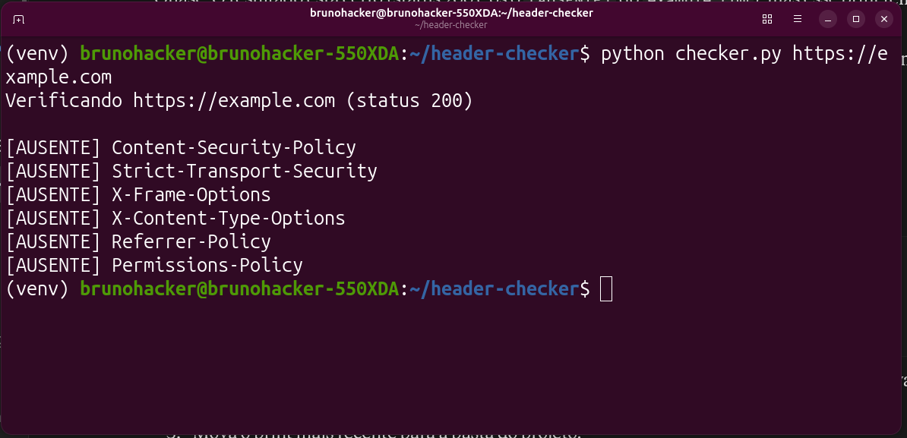
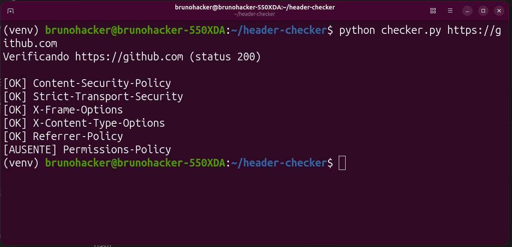

# Header Checker

Verificador de cabeçalhos de segurança HTTP em Python. Informe uma URL e o script mostra quais cabeçalhos importantes estão presentes ou ausentes na resposta do servidor.

## Cabeçalhos verificados

- Content-Security-Policy
- Strict-Transport-Security
- X-Frame-Options
- X-Content-Type-Options
- Referrer-Policy
- Permissions-Policy

## Como instalar

```bash
git clone https://github.com/BrunoCoelho-dev/header-checker.git
cd header-checker
python3 -m venv venv
source venv/bin/activate
pip install requests
```

## Como usar

```bash
python checker.py https://exemplo.com
```

Se o servidor não responder com status 200, o script avisa que os cabeçalhos lidos podem ser de uma página de bloqueio ou erro e não são confiáveis.

## Exemplo de saída




## Por que esses cabeçalhos importam

A ausência deles pode facilitar ataques como clickjacking, XSS e downgrade de conexão. Este projeto faz só a verificação inicial, uma das primeiras etapas de um teste de segurança em aplicações web.

## Aviso de uso

Use apenas em ambientes autorizados, como laboratórios de estudo. Não use contra sistemas de terceiros sem permissão.

## Próximos passos

- [ ] Exportar o resultado em JSON
- [ ] Classificar a severidade de cada cabeçalho ausente
- [ ] Ler várias URLs a partir de um arquivo

## Autor

Bruno Moraes, em busca da primeira oportunidade em segurança ofensiva.
